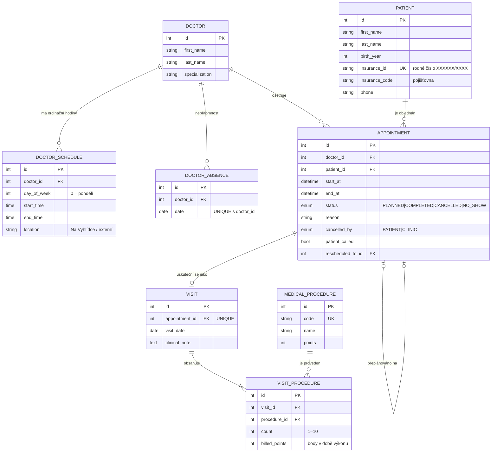

# Ordinace Na Vyhlídce – Rezervační a evidenční systém

Semestrální projekt z předmětu **Pokročilé programování (PPRO)**, ZS 2026/2027
Fakulta informatiky a managementu, Univerzita Hradec Králové
**Zadání A – Rezervace v ordinaci** · **Klient**: MUDr. Jana Hrubá, Ordinace Na Vyhlídce

Webová aplikace pro recepci (paní Věra) a tři lékaře. Nahrazuje papírový diář: eviduje pacienty, lékaře a jejich ordinační hodiny, hlídá, aby nevznikly dvě rezervace na stejný čas, zaznamenává provedené výkony a z nich automaticky skládá měsíční výkaz pro pojišťovny.

📄 Technická dokumentace: [`docs/dokumentace.pdf`](docs/dokumentace.pdf)

---

## 1. Rychlé spuštění

Prerekvizity: **Docker** a **Docker Compose** (Docker Desktop), Git.

```bash
git clone https://github.com/NovakGroup/ppro-clinic-reservation.git
cd ppro-clinic-reservation
docker compose up --build
```

Hotovo – žádné další ruční kroky. Při startu se automaticky provedou migrace databáze a do prázdné databáze se vloží syntetická testovací data.

| Služba | Adresa |
|---|---|
| Webová aplikace (recepce) | http://localhost:8000 |
| API dokumentace (Swagger UI) | http://localhost:8000/docs |
| Health check | http://localhost:8000/health |

**Přihlášení:** aplikace v této fázi přihlášení nevyžaduje (pracuje s ní jen recepce na lokálním počítači, viz Rozhodnutí 2). Databáze běží jen uvnitř Dockeru s výchozím lokálním heslem z `docker-compose.yml`; pro vlastní hodnoty zkopírujte `.env.example` na `.env` (soubor `.env` je v `.gitignore`).

Data se ukládají do Docker volume `db-data`. Návrat k výchozím testovacím datům: `docker compose down -v && docker compose up`.

## 2. Testy

```bash
docker compose run --rm test-unit          # jednotkové testy aplikační logiky (bez databáze)
docker compose run --rm test-integration   # integrační testy proti skutečné PostgreSQL
```

* **Jednotkové** (`backend/tests/unit`): doménová pravidla (překryv intervalů, ordinační hodiny, rodné číslo, telefon), služby nad in-memory repozitáři (kolize, přeplánování, stavy rezervace, výkony a historizace bodů) a **architektonický test**, který hlídá směr závislostí mezi vrstvami.
* **Integrační** (`backend/tests/integration`): REST API + PostgreSQL – exclusion constraint proti překryvu, zákaz mazání historie, souběžná rezervace stejného slotu, výkaz, nepřítomnost lékaře a přeplánování.

## 3. Struktura repozitáře

```
backend/
  app/
    api/            prezentační vrstva – REST endpointy, DTO (schemas), mapování
    services/       aplikační vrstva – případy užití (rezervace, návštěvy, výkazy…)
    domain/         čistá doménová pravidla a výjimky (bez frameworku i DB)
    repositories/   datová vrstva – jediné místo s databázovými dotazy
    db/             ORM modely a připojení k DB
    container.py    kompoziční kořen – skládá vrstvy dohromady
    seed.py         syntetická testovací data
  migrations/       verzované migrace Alembic
  tests/            unit + integration
  Dockerfile, entrypoint.sh, requirements.txt
frontend/index.html webové rozhraní recepce (volá REST API)
index.html          statický klikací prototyp UI (GitHub Pages, data jen v paměti prohlížeče)
docs/               technická dokumentace (PDF)
docker-compose.yml
```

## 4. Architektura (tři vrstvy, závislosti jen jedním směrem)

```
Prezentační vrstva   app/api        FastAPI endpointy, validace formátu vstupu (Pydantic)
        │
        ▼
Aplikační vrstva     app/services   obchodní pravidla, transakce (+ app/domain: čistá pravidla)
        │
        ▼
Datová vrstva        app/repositories + app/db   SQLAlchemy, PostgreSQL, migrace Alembic
```

* Endpointy volají jen služby. SQL ani repozitáře v `app/api` nejsou – hlídá to test `tests/unit/test_architecture.py`.
* Služby nepoužívají SQLAlchemy ani FastAPI; pracují s repozitáři přes *unit of work*, takže je lze testovat nad in-memory náhradou.
* Vrstvy propojuje jen `app/container.py` (dependency injection přes FastAPI `Depends`).

## 5. Datový model

8 entit, vazba **M:N** Návštěva ↔ Výkon přes vazební entitu `VISIT_PROCEDURE` s atributy *počet* a *body v době výkonu*.



### Pravidla klienta a kde se vynucují

| Pravidlo | Aplikace (služba) | Databáze |
|---|---|---|
| Dvě rezervace na stejný čas u jednoho lékaře nesmí vzniknout „ani omylem, ani ručně“ | `BookingService.create` – kontrola překryvu + zámek řádku lékaře (`SELECT … FOR UPDATE`) | exclusion constraint `ex_appointment_no_overlap` nad `tsrange(start_at, end_at)` pro aktivní stavy |
| Rezervace jen v ordinačních hodinách lékaře (ne na externím pracovišti, ne o víkendu, ne v minulosti, ne v den nepřítomnosti) | `rules.validate_booking_time` | – |
| Výkon nelze zapsat k neuskutečněné návštěvě | `VisitService.save` (jen stav `COMPLETED`) | – |
| Historie pacienta se nemaže | žádné mazací endpointy | triggery odmítnou `DELETE` z `patient`, `appointment`, `visit` |
| Pacient je jednoznačný | normalizace a kontrola RČ | `UNIQUE (insurance_id)` |

## 6. Rozhodnutí k otevřeným bodům zadání

1. **Délka termínu.** Diář má pevnou mřížku po 15 minutách, rezervace má vlastní délku 15/30/45/60 min a vždy začíná na hraně mřížky. Termíny mohou navazovat (interval `[začátek, konec)`). Kombinuje přehlednost mřížky s tím, že „podle toho, co se dělá“.
2. **Kdo zakládá rezervaci.** V této verzi výhradně recepce. Online objednávání pacientů není součástí řešení; díky REST API a pravidlům v aplikační vrstvě jde doplnit později bez změny logiky (přibyla by autentizace a role).
3. **Zrušená rezervace.** Nemaže se: změní stav na `CANCELLED` (pacient se omluvil) nebo `NO_SHOW` (nepřišel bez omluvy) a tím se z diáře uvolní slot. Záznam zůstává pro statistiku; jako rizikový je pacient označen od 3 neomluvených absencí. Přeplánování ze strany ordinace (`cancelled_by = CLINIC`) se pacientovi nepočítá.
4. **Totožnost pacienta.** Jednoznačným klíčem je číslo pojištěnce (rodné číslo) – ověřuje se formát i kontrolní číslice a ukládá se v jednotném tvaru, takže duplicitu pozná i zápis bez lomítka. Pokus o duplicitu se odmítne s informací, kdo už je v kartotéce. Rok narození musí odpovídat RČ.
5. **Nemoc lékaře.** Recepce zaeviduje nepřítomnost lékaře na konkrétní den; diář lékaře se ten den zablokuje a zobrazí se seznam dotčených pacientů s telefony. Systém nic neruší sám: recepce u každého označí „Zavoláno“ a termín přeplánuje (původní se zruší až po úspěšném uložení nového).

## 7. Použité technologie

* **Python 3.12 + FastAPI** – stručný a čitelný kód, automatická OpenAPI dokumentace, snadné testování.
* **PostgreSQL 16** – exclusion constraint nad časovými intervaly vynutí zákaz překryvu přímo v databázi.
* **SQLAlchemy 2** – ORM a dotazy soustředěné v repozitářích.
* **Alembic** – verzované migrace schématu.
* **Pydantic** – validace vstupních DTO.
* **pytest** – jednotkové i integrační testy.
* **Docker + Docker Compose** – spuštění celé aplikace jedním příkazem.
* **HTML + Tailwind CSS + čistý JavaScript** – jednoduché rozhraní bez build kroku.

## 8. Historie změn

* `2026-10-23` – inicializace repozitáře, pravidla spolupráce (`agent.md`), návrh a specifikace zadání A.
* `2026-10-30` – klikací prototyp UI; oprava chyb prototypu (ordinační hodiny, kolize, validace, výkazy, výpadek lékaře); kompaktní hlavička.
* `2026-10-30` – backend FastAPI ve třech vrstvách, PostgreSQL s migracemi, exclusion constraint a zákaz mazání historie v DB, frontend napojený na REST API, týdenní přehled volných termínů, rok narození pacienta, Docker Compose, jednotkové a integrační testy, technická dokumentace.
