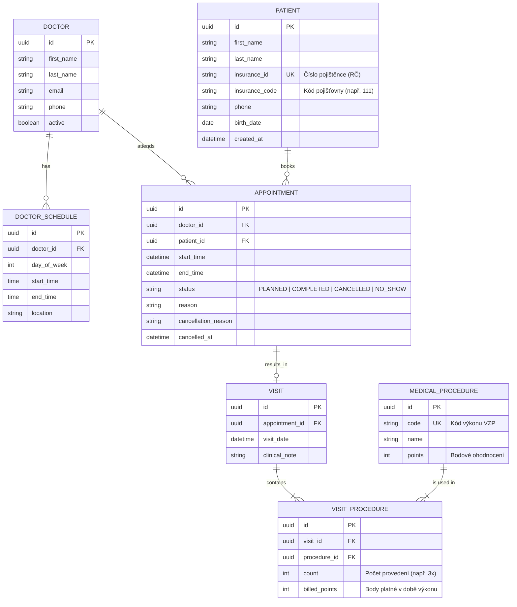

# Ordinace Na Vyhlídce – Rezervační a evidenční systém

Semestrální projekt z předmětu **Pokročilé programování (PPRO)**, ZS 2026/2027  
Fakulta informatiky a managementu, Univerzita Hradec Králové  
**Klient**: MUDr. Jana Hrubá, Ordinace Na Vyhlídce  

---

> **Aktuální stav repozitáře:** obsahuje klikatelný prototyp uživatelského rozhraní (`index.html`), který běží čistě v prohlížeči nad syntetickými daty v paměti (po obnovení stránky se data vrátí do výchozího stavu). Doménová pravidla jsou v prototypu implementována v JavaScriptu jako předloha pro aplikační vrstvu. Backend, databáze, Docker a automatické testy popsané níže jsou **plánované** a v repozitáři zatím nejsou.

---

## 1. Popis projektu a cíl řešení
Cílem projektu je nahradit dosavadní papírový diář a ruční přepisování vykázaných bodů moderní webovou aplikací pro recepci ordinace (paní Věra) a 3 lékaře.

### Klíčové přínosy:
1. **Eliminace kolizí termínů**: Systém znemožní vznik dvou překrývajících se rezervací u jednoho lékaře.
2. **Respektování ordinačních hodin**: Rezervaci lze vytvořit pouze v platném časovém okně daného lékaře na pracovišti Na Vyhlídce.
3. **Automatizace měsíčních výkazů**: Okamžitý souhrn provedených výkonů a bodů pro zdravotní pojišťovny za vybraného lékaře a kalendářní měsíc.
4. **Evidence nespolehlivých pacientů**: Sledování zrušených rezervací a absencí bez omluvy.

---

## 2. Architektura aplikace (Třívrstvá)
Aplikace striktně dodržuje třívrstvou architekturu se závislostmi vedoucími **výhradně jedním směrem**:

```
[ Prezentační vrstva / REST API & UI ]
                 │
                 ▼
     [ Aplikační & Doménová logika ]
                 │
                 ▼
[ Datová vrstva / Repozitáře & Migrace (PostgreSQL) ]
```

1. **Prezentační vrstva (Web UI & REST API)**:
   - Zpracovává HTTP požadavky, provádí základní validaci vstupních formátů DTO a vrací odpovědi.
   - Neobsahuje žádnou doménovou ani byznysovou logiku a **nikdy nevolá databázi ani SQL napřímo**.
2. **Aplikační a doménová vrstva (Services / Use Cases)**:
   - Zajišťuje veškerá byznysová pravidla (kontrola ordinační doby lékaře, detekce časových překryvů rezervací, validace stavu návštěvy před přiřazením výkonu, výpočet bodů).
   - Nezávisí na konkrétním webovém frameworku.
3. **Datová vrstva (Persistence / Repositories)**:
   - Zajišťuje ukládání a načítání entit z relační databáze (PostgreSQL).
   - Používá transakční zpracování s databázovými zámky k zabránění souběhu při rezervacích (race conditions).
   - Schéma je spravováno verzovanými migracemi.

---

## 3. Datový model

Datový model splňuje povinné minimum (7 entit a vazba M:N s atributem počtu):



### Řešení klíčových omezení (Business & DB Constraints):
* **Zákaz překryvu termínů**: Zajištěno na úrovni doménové služby a podpořeno databázovým indexem/omezením na intervaly `[start_time, end_time)` pro aktivní rezervace daného lékaře. Interval je polootevřený – nový termín smí začít přesně v okamžiku konce předchozího (např. 08:15–08:30 a 08:30–08:45 je platné).
* **Ordinační hodiny**: Rezervace musí celá ležet uvnitř jednoho okna `DOCTOR_SCHEDULE` lékaře na pracovišti Na Vyhlídce (začátek i konec), začínat v 15minutové mřížce, nesmí být o víkendu, v minulosti ani v den evidované nepřítomnosti lékaře. Okna s jiným `location` (např. úterní odpoledne MUDr. Svobody) se v diáři zobrazují jako blokovaná.
* **Číslo pojištěnce**: Ukládá se v normalizovaném tvaru `XXXXXX/XXXX`; při zakládání se ověřuje formát (9 nebo 10 číslic, platný měsíc a den, u 10místného čísla kontrolní dělitelnost 11) a unikátnost bez ohledu na zápis (s lomítkem / bez lomítka).
* **Vazba M:N**: Realizována vazební entitou `VISIT_PROCEDURE` spojující `VISIT` a `MEDICAL_PROCEDURE` s doplňkovým údajem `count` (počet aplikací) a historizovaným počtem bodů `billed_points`.
* **Zákaz mazání historie**: Pacienti ani návštěvy se fyzicky nemažou (pouze soft delete / auditní log).

---

## 4. Rozhodnutí k otevřeným bodům ze zadání

Podle metodiky projektu jsou níže zapsána jednoznačná rozhodnutí k bodům, které klient neměl dořešené:

1. **Délka termínu (pevná mřížka vs. dynamická délka)**:
   * *Rozhodnutí*: Diář bude pracovat s 15minutovými základními sloty. Každá rezervace má definovanou délku v násobcích 15 minut (výchozí délka je 15 minut, s možností prodloužení na 30/45/60 min dle typu zákroku). Tím je zachována flexibilita bez vzniku neuspořádaných časových fragmentů.
2. **Kdo zakládá rezervaci (recepce vs. online pacienti)**:
   * *Rozhodnutí*: V první fázi vytváří rezervace výhradně recepce (paní Věra) v autentizovaném rozhraní. Architektura je však navržena s čistým REST API, které umožní budoucí napojení pacientského portálu bez úprav doménové logiky.
3. **Co se zrušenou rezervací (odstranění z diáře vs. statistika)**:
   * *Rozhodnutí*: Zrušená rezervace se nemaže z databáze, ale změní stav na `CANCELLED` (příp. `NO_SHOW`), čímž se její časový interval okamžitě uvolní v kalendáři pro jiné pacienty. Současně zůstává v databázi pro statistiky nespolehlivých pacientů.
   * `CANCELLED` = pacient se předem omluvil; `NO_SHOW` = nedostavil se bez omluvy (lze zaznamenat jen u termínu, který už nastal). Pacient je označen jako rizikový od 3 neomluvených absencí. Přeplánování z důvodu na straně ordinace (např. nemoc lékaře) se pacientovi jako zrušení nezapočítává.
   * Odbavenou (`COMPLETED`) návštěvu již nelze zrušit.
4. **Totožnost pacienta a duplicity (např. paní Nováková)**:
   * *Rozhodnutí*: Jednoznačným přirozeným identifikátorem pacienta je číslo pojištěnce (rodné číslo). Systém při zakládání nedovolí duplicitní identifikátor a při vyhledávání v recepci nabízí našeptávač podle příjmení i telefonního čísla.
5. **Nemoc lékaře a výpadek ordinace**:
   * *Rozhodnutí*: Systém umožní označit nedostupnost lékaře a nabídne recepční přehledný interaktivní seznam všech dotčených rezervací s kontakty pro telefonické obvolání a tlačítky pro hromadné/individuální přeplánování na jiný termín či lékaře.
   * V den evidované nepřítomnosti je diář lékaře pro nové rezervace zablokován. Původní termín se při přeplánování zruší až po úspěšném uložení náhradního termínu.

---

## 5. Použité technologie (Návrh ke schválení)

* **Backend**: Python 3.12 s frameworkem **FastAPI** (rychlost, automatická OpenAPI/Swagger dokumentace, čistá architektura, snadné testování) nebo **Java 21 / Spring Boot** (dle vaší osobní preference pro výuku na FIM UHK).
* **Databáze**: **PostgreSQL 16** (silná podpora časových intervalů, integritních omezení a transakcí).
* **Migrace**: **Alembic** (v případě Pythonu) nebo **Flyway** (v případě Javy).
* **Kontejnerizace**: **Docker** & **Docker Compose** pro jedno-příkazové spuštění celé infrastruktury.
* **Testování**: **pytest** + `Testcontainers` / testovací DB pro integrační testy.

---

## 6. Spuštění projektu

### Prototyp UI (aktuální stav)
Stačí otevřít soubor `index.html` v prohlížeči (vyžaduje připojení k internetu kvůli Tailwind CSS z CDN). Data jsou syntetická a vztažená k aktuálnímu týdnu.

### Plná aplikace (plánováno – zatím není v repozitáři)

#### Prerekvizity
* Nainstalovaný `Docker` a `docker compose`.
* Git.

#### Postup krok za krokem
1. Klonování repozitáře:
   ```bash
   git clone https://github.com/NovakGroup/ppro-clinic-reservation.git
   cd ppro-clinic-reservation
   ```
2. Vytvoření souboru prostředí:
   ```bash
   cp .env.example .env
   ```
3. Spuštění kompletního prostředí:
   ```bash
   docker compose up --build
   ```
4. Aplikace a dokumentace jsou dostupné na:
   * Webová aplikace: `http://localhost:8000`
   * API dokumentace (Swagger): `http://localhost:8000/docs`

---

## 7. Testování (plánováno)
* **Jednotkové testy** (aplikační logika, validace překryvů, výpočet bodů):
  ```bash
  docker compose run --rm test-unit
  ```
* **Integrační testy** (proti reálné PostgreSQL databázi):
  ```bash
  docker compose run --rm test-integration
  ```

---

## 8. Historie změn (Changelog)
* `2026-10-23`: Inicializace repozitáře, definice pravidel spolupráce (`agent.md`), architektonický návrh a specifikace zadání A v `README.md`.
* `2026-10-30`: Oprava prototypu UI – vynucení ordinačních hodin dle strukturovaného rozvrhu lékařů, polootevřené intervaly kolizí (termín smí navazovat), validace času a 15min mřížky, výběr data v rezervaci, rozlišení `CANCELLED` / `NO_SHOW`, validace a normalizace RČ a telefonu, ochrana proti XSS, skutečné ukládání návštěv a výkonů (historizované body), výkazy počítané z dat s filtrem lékaře a měsíce a exportem CSV, evidence nepřítomnosti lékaře s blokací diáře a přeplánováním, vyhledávání bez diakritiky. Odstraněn duplicitní `prototype.html`, přidán `.gitignore`, README uvedeno do souladu se skutečným stavem.
